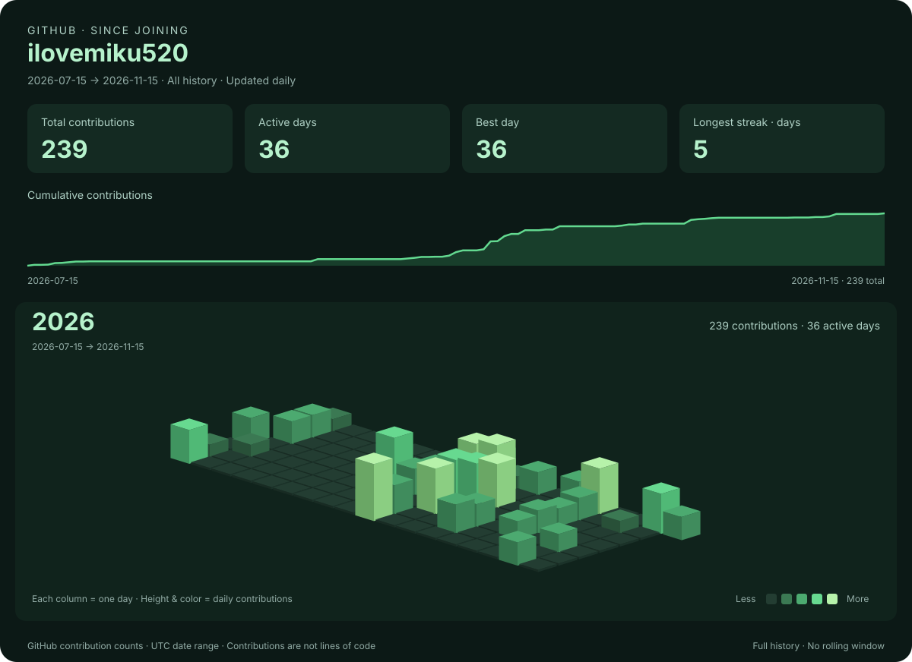

# ilovemiku520

Hi there, welcome to my profile 👋

  

## GitHub Contributions · Since Joining

From **July 15, 2026**, the day I joined GitHub, through the latest daily update.

- Counts follow [GitHub's contribution rules](https://docs.github.com/en/account-and-profile/reference/profile-contributions-reference). They measure contributions, **not lines of code**.

- [Daily source data](./assets/contribution-history.json) · [Automatic update workflow](https://github.com/ilovemiku520/ilovemiku520/actions/workflows/profile-3d-contrib.yml)

## Contact

- Email: [ilovemiku520@outlook.com](mailto:ilovemiku520@outlook.com)
- Google Email: [hatsunemikuismymaster@gmail.com](mailto:hatsunemikuismymaster@gmail.com)

## Personal Blog

- Blog: [https://ilovemiku.me](https://ilovemiku.me)
- Access password: `hatsunemiku`
